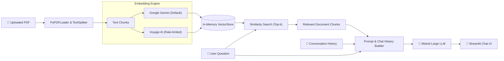

# 📚 DocQnA — AI-Powered PDF Assistant

[](https://www.python.org/)
[](https://streamlit.io/)
[](https://www.langchain.com/)
[](https://mistral.ai/)
[](https://ai.google.dev/)

An intelligent, conversational **Retrieval-Augmented Generation (RAG)** application built with Streamlit and LangChain. Upload any PDF document and chat with its contents naturally with full context retention across conversation turns.

---

## ✨ Features

- 📄 **Instant PDF Ingestion**: Upload documents with automatic chunking (`RecursiveCharacterTextSplitter`) and in-memory vector storage (`InMemoryVectorStore`).
- 🧠 **Dual Embedding Support**:
  - **Google Gemini** (`models/gemini-embedding-001`): Direct, ultra-fast embedding ingestion.
  - **Voyage AI** (`voyage-4-lite`): Rate-limited batch processing designed for strict API quotas.
- 💬 **Conversational Memory**: Maintains chat history and feeds previous turns into the LLM context so you can ask natural follow-up questions.
- 🎨 **Modern Streamlit Interface**:
  - Wide responsive dashboard with user (`👤`) and bot (`🤖`) avatars.
  - Active document tracking with quick "New File" and "Clear Chat" controls.
  - Sidebar engine diagnostics displaying live provider settings.
- 🧱 **Clean Architecture**: Complete separation of UI ([`app.py`](app.py)) and backend LLM operations ([`llm_integration.py`](llm_integration.py)).

---

## 🏗️ System Architecture



---

## 📁 Project Structure

```text
qna-bot/
├── app.py                 # Streamlit UI, state management, and interaction flows
├── llm_integration.py     # LLMIntegration class (embeddings, vector store, completions)
├── pyproject.toml         # Project dependencies and packaging metadata
├── uv.lock                # Deterministic dependency lockfile (managed via uv)
├── .env                   # API keys and environment configurations (git-ignored)
└── .gitignore             # Git ignore rules (caches, virtualenvs, PDFs, keys)
```

---

## 🚀 Getting Started

### 1. Prerequisites

- Python 3.14+ (or compatible 3.10+)
- [`uv`](https://github.com/astral-sh/uv) (recommended) or standard `pip`

### 2. Clone the Repository

```bash
git clone https://github.com/your-username/qna-bot.git
cd qna-bot
```

### 3. Configure Environment Variables

Create a `.env` file in the root directory:

```env
# Required: LLM API key (Mistral via OpenAI-compatible endpoint)
XKIRO_API_KEY=your_xkiro_api_key_here

# Required for Gemini embeddings (default)
GOOGLE_API_KEY=your_google_api_key_here

# Optional: Required only if using Voyage AI embeddings
VOYAGE_API_KEY=your_voyage_api_key_here
```

### 4. Install Dependencies

Using **uv** (recommended):

```bash
uv sync
```

Or using standard **pip**:

```bash
pip install -e .
```

### 5. Run the Application

```bash
uv run streamlit run app.py
```

*Or if you activated your virtual environment:*

```bash
streamlit run app.py
```

The app will launch in your browser at `http://localhost:8501`.

---

## ⚙️ Configuration

### Switching Embedding Providers

The embedding engine is configured in [`llm_integration.py`](llm_integration.py) and defaults to **Gemini**:

```python
# In llm_integration.py:
class LLMIntegration:
    DEFAULT_PROVIDER: Provider = "gemini"  # Change to "voyage" if desired
```

You can also pass it dynamically when initializing the bot in [`app.py`](app.py):

```python
# To switch to Voyage AI:
bot = LLMIntegration(embedding_provider="voyage")
```

---

## 🛠️ Tech Stack

- **Frontend & App Framework**: [Streamlit](https://streamlit.io/)
- **Orchestration**: [LangChain](https://www.langchain.com/) (`langchain-core`, `langchain-text-splitters`, `langchain-google-genai`, `langchain-voyageai`)
- **Document Ingestion**: `pypdf`, `langchain-community`
- **Embedding Models**: Google `models/gemini-embedding-001` & Voyage `voyage-4-lite`
- **Generation Model**: `mistralai/mistral-large-2512`
- **Package Management**: [`uv`](https://github.com/astral-sh/uv)

---

## 🤝 Contributing

Contributions, issues, and feature suggestions are welcome! Feel free to open an issue or pull request.

---

## 📄 License

This project is licensed under the MIT License.
